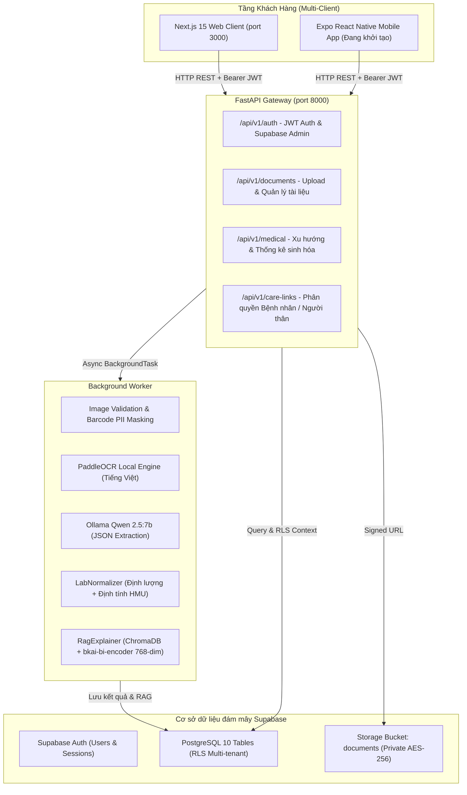

# MEDIREAD AI – BÁO CÁO KHẢO SÁT HỆ THỐNG HIỆN TẠI (MOBILE AUDIT)

**Ngày khảo sát:** 15/11/2026  
**Phiên bản dự án:** MediRead AI 2.0.0 (Production-ready)  
**Phạm vi:** Khảo sát Backend FastAPI, Background Worker (PaddleOCR + Qwen 2.5 + ChromaDB RAG), Database Supabase PostgreSQL, và Web App Next.js 15 để chuẩn bị triển khai Mobile App độc lập bằng Expo React Native.

---

## 1. TỔNG QUAN KIẾN TRÚC HỆ THỐNG HIỆN TẠI

MediRead AI được thiết kế theo kiến trúc vi dịch vụ module hóa (Decoupled Modular Architecture):

---

## 2. KHẢO SÁT CHI TIẾT CÁC API BACKEND SẴN CÓ CHO MOBILE

Backend FastAPI hiện đang chạy tại `http://localhost:8000` (hoặc IP mạng nội bộ `http://172.16.0.2:8000` cho thiết bị di động kết nối qua WiFi).

| Endpoint | Method | Chức năng | Phù hợp Mobile App |
|---|---|---|---|
| `/api/v1/auth/accounts` | `GET` | Lấy danh sách hồ sơ mẫu/đã đăng ký trên Supabase | Màn hình chọn hồ sơ nhanh & thử nghiệm |
| `/api/v1/auth/login` | `POST` | Đăng nhập bằng `user_id` hoặc số điện thoại, cấp HS256 JWT | Màn hình Đăng nhập |
| `/api/v1/auth/register` | `POST` | Đăng ký tài khoản bệnh nhân/người chăm sóc mới | Màn hình Đăng ký |
| `/api/v1/auth/me` | `GET` | Lấy thông tin người dùng đang đăng nhập & cài đặt | Khởi động app, kiểm tra phiên session |
| `/api/v1/documents/upload` | `POST` | Tải ảnh chụp/file tài liệu lên, kích hoạt PaddleOCR + RAG | Màn hình Quét / Chụp tài liệu (Camera/Picker) |
| `/api/v1/documents` | `GET` | Lấy danh sách tài liệu đã xử lý của người dùng | Màn hình Lịch sử & Trang chủ |
| `/api/v1/documents/{id}` | `GET` | Lấy chi tiết OCR, bảng chỉ số sinh hóa & lời giải thích RAG | Màn hình Chi tiết phiếu khám / Đơn thuốc |
| `/api/v1/documents/{id}/confirm` | `POST` | Người dùng xác nhận hoặc sửa đổi kết quả đọc | Màn hình Kiểm tra & Xác nhận kết quả |
| `/api/v1/medical/trends` | `GET` | Thống kê biến động theo mã chỉ số (Glucose, Creatinin...) | Màn hình Xu hướng sức khỏe & Biểu đồ |
| `/api/v1/care-links` | `GET` | Danh sách liên kết bệnh nhân và người chăm sóc | Màn hình Người chăm sóc / Quản lý gia đình |
| `/api/v1/care-links/request` | `POST` | Gửi yêu cầu kết nối theo mã định danh | Màn hình Kết nối người thân |
| `/api/v1/care-links/{id}/accept`| `POST` | Chấp nhận yêu cầu kết nối | Màn hình Phê duyệt kết nối |
| `/health/ready` | `GET` | Kiểm tra tình trạng sẵn sàng của OCR, LLM, Database | Kiểm tra kết nối mạng/máy chủ |

---

## 3. CÁC ĐIỂM CẦN LƯU Ý KHI KẾT NỐI MOBILE APP

1. **Địa chỉ mạng (Host URL)**:
   - Khi chạy trên giả lập Android Emulator, `localhost` tương ứng với `10.0.2.2`.
   - Khi chạy trên điện thoại thật qua Expo Go (quét QR code), phải sử dụng IP LAN của máy tính phát triển: `http://172.16.0.2:8000`. Cấu hình này sẽ được đưa vào file `.env` của Expo (`EXPO_PUBLIC_API_URL`).
2. **Quản lý Token an toàn**:
   - Web dùng `localStorage`. Trên Mobile bắt buộc dùng **`expo-secure-store`** để mã hóa token sinh trắc học và chống trích xuất từ file hệ thống.
3. **Chụp ảnh và tải lên**:
   - Sử dụng **`expo-camera`** và **`expo-image-picker`** trả về URI cục bộ của ảnh chụp, sau đó đóng gói thành `FormData` và gửi kèm Bearer JWT.
4. **Hỗ trợ người cao tuổi (Voice & Accessibility)**:
   - Sử dụng thư viện gốc **`expo-speech`** để đọc to kết quả bằng giọng tiếng Việt (hỗ trợ điều chỉnh tốc độ đọc `rate: 0.8` chậm rãi, rõ ràng cho các cụ già).

---

## 4. KẾ HOẠCH TRIỂN KHAI MOBILE APP (ROADMAP)

- **Bước 1**: Phân tích thư viện thiết kế Figma (`docs/MOBILE_FIGMA_DESIGN_MAPPING.md`).
- **Bước 2**: Khởi tạo cấu trúc dự án Expo React Native TypeScript tại thư mục `mobile/`.
- **Bước 3**: Xây dựng Theme System (Màu sắc, Typography, Spacing theo đúng Figma).
- **Bước 4**: Xây dựng API Client & Auth Provider (SecureStore).
- **Bước 5**: Xây dựng Navigation & Bottom Tabs (Trang chủ, Quét đơn, Lịch sử, Xu hướng, Tài khoản).
- **Bước 6**: Xây dựng màn hình Chụp/Quét (`expo-camera` / Picker) & Chi tiết chỉ số + RAG Explanations + TTS Voice.
- **Bước 7**: Xây dựng màn hình Lịch thuốc & Liên kết Người chăm sóc.
- **Bước 8**: Kiểm thử TypeScript, Expo Doctor và hoàn thiện tài liệu hướng dẫn vận hành.
